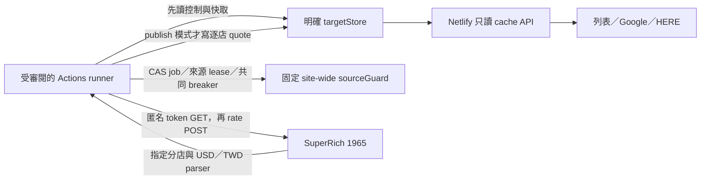

# SuperRich 1965：GitHub Actions 抓取與 Netlify 逐店快取計畫

更新日期：2026-10-20（Asia/Taipei）。本次是實作前調查與計畫，基準 commit `5ee520c`。
**Actions runner、workflow、Secrets、Preview target 管理及排程皆尚未實作。**
本次不呼叫 SuperRich、不執行 workflow、不改環境設定或 Blobs、不部署、不 commit。
已退役的 Netlify 抓價入口不恢復；目前遠端部署是否已套用退役 commit，本次未重新查核。

詳細公開證據、SDK 核對與平台限制見 [本次調查](superrich1965-actions-research-2026-10-20.zh-TW.md)。
本機成功與 Netlify 403／本站 429 的歷史見 [匿名 API 紀錄](superrich1965-anonymous-api-investigation.zh-TW.md)。

## 建議決定

1. 使用標準 GitHub-hosted Linux runner、Node 22、現有匿名 API transport 與 JS parser。
   先手動 probe 一家，不發布報價；來源可用性通過後才接 Preview 發布、少量分店、38 家。
2. 直接寫入 Netlify 既有逐店 Blobs cache，不 commit 報價、不靠重新部署更新數字。
   Netlify 仍只提供快取 API、前端與控制工具，綠標不改。
3. **報價 target 與來源保護分開：** Preview 用明確 deploy store，production 用 site-wide
   store；另用固定 site-wide source guard 保存跨 target 的冷卻與來源互斥。
4. 新增專用 Actions CLI，從既有逐店／批次核心抽出必要能力；不直接搬舊完整快照 CLI，
   不重寫 parser，不把現有 query 成功寫入行為稱為「不發布 probe」。
5. 首版只有手動、受審閱程式與明確 target；來源不通就停止並記錄，不升級 Chromium、
   換介面重試、清除冷卻或擴大 38 家。排程與正式切換最後才做。

第一份實作交付應完成 P0～P3 的 mock 驗證與可審閱程式；首次來源測試須先完成
workflow 預設分支 bootstrap、target/control 設定及既有工作查核。
本文件不把上述準備當成已完成，也不授權發布、合併或觸發新的遠端工作。

## 證據與缺口

| 已知事實 | 實作含義 |
| --- | --- |
| 本機 A04／36 曾取得 token／rate 各一次 200，指定 USD／TWD 有效 | 可以重用匿名 transport，尚不能保證 GitHub runner 通過 |
| Netlify Preview 在 token GET 收到 403 challenge，未送 rate POST | 來源 403 與本站保護性 429 分開記錄；不再調整 Netlify browser |
| ThaiCash 標準 runner 有單店公開成功資料，但不含 TWD／精確面額驗收 | 支持先驗一家；不能當成本專案 38 家驗收。固定 run／輸出見調查文件 |
| 現有公開三個 API 已在程式改為只讀 | 新增發布器即可沿用前端；缺報價時不由按鈕補抓來源 |
| queryBranchRates 可能初始化 control，成功一定寫 quote | 必須增加既有 control 前置要求與 probe 不發布分支 |
| runSlowBatch 只認領已存在 job，回傳 loaded 等少量欄位 | 須補 job 建立、rerun 冪等、取消與來源／發布 coverage |
| 每個 Preview 的 control／breaker／gate 獨立 | 不能只讀新 target 就宣稱尊重跨部署冷卻，須補共同 source guard |
| 舊 CLI 使用原 HTTP 路徑、local profile、完整 snapshot | 保留既有語意，不能只設定舊 env 就作為新 runner |

不修改 Notion、CSV、分店 Slug、Google／HERE、USD／TWD 面額、報價排序及到期公式。

## 資料流程與 target



### 明確且受控的目標

| 目標 | Store | 必要核對 |
| --- | --- | --- |
| preview-reviewed | getDeployStore：exchange-rates-1965 | 固定 siteID、不可變 deployID、預期 branch／commit／context、部署 ready |
| production | getStore：exchange-rates-1965 | 固定 siteID、main 的受審閱正式部署、runtime production context；不接受 Preview deployID |
| 共同來源保護 | getStore：exchange-rates-1965-source-guard（新） | 與 quote target 分離，跨部署固定；不得以改 target／region 另建空 guard |

新增外部 store factory，不改現有 createAdminStore 的預設語意。
它不能從 production fallback、Preview alias、使用者提供的 URL 或本機 Netlify link 猜目標。
純 Actions 傳入 siteID／token／deployID，使用 SDK 已支援的 region 行為；不注入
NETLIFY_BLOBS_CONTEXT／NETLIFY_DEV 或複製 Netlify 函式憑證。

建議以受審閱的 target 設定檔固定上述身分，CLI／workflow 只選 alias。
實作時再定案檔名，例如 `config/exchange-rates-1965-actions-targets.json`；這不是現有檔案。
使用固定 Netlify API 核對 deploy metadata；不符、無法辨識、非 ready、讀取失敗都來源 0。
明確 Preview control 的 status／初始化／enable 管理目前也缺接線，列入 P1；
**來源工作本身不建立 control、不自動 enable。**

Preview alias 換到新 deploy 後會改讀新 store，舊報價與 control 不會自動跟過去。
重新綁定要重核 target；production 採正常 main 正式部署，不把 Preview quote 或時間
重標成正式報價。手動 promote 舊 Preview 的 runtime context 尚未驗證，本案不依賴它。
namespace／外部參數依 [Blobs 官方文件](https://docs.netlify.com/build/data-and-storage/netlify-blobs/)。

### 共同來源冷卻與互斥

新增薄的 source-guard helper，沿用現有 breaker transition 與 ETag CAS。
建議單一有界 state 包含 schemaVersion、固定 sourceEpoch、paused、breaker、
leaseId、leaseUntilMs、nextRequestAtMs、unresolvedAttempt；breaker 的 controlVersion 綁 sourceEpoch，
不綁任一 target 的 controlVersion。缺失、損壞、讀取失敗或 epoch 不符均停止來源。

Bootstrap 是明確的維運操作，不由抓價工作自動完成：

1. 核對仍可能抓來源的舊 Netlify 部署、未完成工作與本機 collector；確保它們停止。
   新 guard 無法約束仍執行舊程式的 collector。Actions 接手期間也不與舊 CLI 並行；
   日後恢復舊 CLI 前先暫停 Actions、核對工作與共同冷卻，不將它當作即時 fallback。
2. 讀取已知舊 deploy 與 production breaker，包括原 Preview `6ad48de20cfce14e8ddd926f`
   與 `6ad62ddf1a2369d43e1e364e`，並列出切換時實際仍相關的其他部署。
   這是後續查核清單，不是本次讀取結果。
3. 以 CAS 建立 paused guard，保留較晚 blockedUntil、較嚴格封鎖等級及必要失敗歷史；
   相同來源未到期封鎖不能因舊 target 停用、版本不同或新 guard 而丟失。
4. 狀態不明時保持 paused；正常啟用也不換 sourceEpoch 或清除有效冷卻。
   既有 target control 管理與 global pause 分別顯示，避免誤把來源停用當成快取刪除。

來源請求流程：先驗 target control／cache／原 breaker／gate，再取得共同 source lease；
重新核對控制、共同冷卻與剩餘租約後才取 token。成功 cache hit 不取得來源 lease。
403／429／challenge 的 outcome **先持久化到 global guard**，即使 target 隨後停用或
版本改變也保留封鎖，再處理 target breaker／發布檢查。單店成功不清升級歷史；
global breaker 到自動停用條件時先 paused，不能讓換 target 繼續抓。

保留既有首次 challenge 6 小時、第二次 24 小時、第三次停用，以及 Retry-After
的較晚截止；保留普通失敗退避，不新增來源重試。每家失敗同時涉及兩處保護狀態，
沒有跨 key 交易可假定，因此來源前須以同一 guard CAS 留下 unresolvedAttempt
（operation／owner／slug／開始時間），確認成功才發請求。只有 global outcome 與保護
狀態成功持久化後才能清除此標記。403 後寫入失敗或來源中 hard kill 時，下一輪即使
lease 已過期，仍以 unknown_outcome 暫停來源，需 inspect／受控核對後恢復；
不能因普通 lease 到期便抹去可能已發生的封鎖。

## Collector 與執行契約

### 專用 CLI 與模式

規劃新增 `scripts/exchange-rates-1965-actions.mjs` 與 `fx:1965:actions`。
以下僅為**尚未實作的介面設計，不能直接執行**：

```text
fx:1965:actions inspect --target preview-reviewed
fx:1965:actions probe --target preview-reviewed --slug superrich1965-58
fx:1965:actions publish --target preview-reviewed --scope single|pilot|all
```

- inspect 預設只讀目標／控制／冷卻，不接觸來源、不寫 state；不得把缺參數視為 publish。
- probe 固定先測 superrich1965-58（officialId=58，A04／36），成功不寫 quote／snapshot。
  lease、job／operation 紀錄、失敗 breaker 仍會持久化；它不是遠端唯讀 dry-run。
- publish 明確選用：single 仍是同一家，pilot 是受審閱的固定少量 Slug，all 是正式
  mapping 的 38 個唯一 Slug。拒絕未知／重複 Slug、任意 branchNo／company／URL／force。
- 缺憑證、target 不符、缺少或停用 control、active breaker／pause／busy 都不取 token。
  明確傳 enabledDefault=false、expectedControlVersion，避免 env 初始化控制。
- 保留 queryBranchRates 的 parser／cache／lease／CAS 邏輯，新增 publishQuote=false
  與 sourceGuardStore 等必要接線；內部回傳結構化結果，公開 API envelope 不擴充診斷。
- cache hit 如實記錄，不能清 cache、強制刷新或提前刷新來製造來源成功。
  publish 輪次只更新已到原半小時刷新邊界的分店；probe 也遵守相同刷新資格。

### 時間、token、請求數與取消

一輪一個 createAnonymousApiSource session，直接搭配 ANONYMOUS_SOURCE_PROFILE；
不再使用已刪除的 createSourceSession。token 只存記憶體，close 時清除，不持久化。

| 項目 | 規劃沿用／補上 |
| --- | --- |
| Token＋rate | 同一家共用 12 秒來源 timeout、15 秒 deadline；不各自另開完整預算 |
| Lease | 沿用至少 deadline＋9 秒的保護，來源前與發布前檢查 ownership／剩餘時間 |
| 串行與間隔 | 不平行抓 38 家，每家完成後隨機等 2～5 秒；原 target gate 最少 1.5 秒仍保留 |
| 整輪 | 12 分鐘應用預算；GitHub job 可設 20 分鐘容納 checkout／安裝／清理，不放寬來源預算 |
| Token 重用 | 已知 TTL 預留 30 秒；未知 TTL 不跨店重用，到期可在下一家正常取得新 token |
| 同次失敗 | 401、錯誤 JSON、缺面額、timeout、403／429／challenge 均不自動重試或 fallback |
| 取消 | 將外部 AbortSignal 傳入 collector、source 與 sleep；SIGTERM 停止新增店並取消當前請求 |
| Storage 延遲 | SDK 另有內部重試，須測慢讀寫與 deadline；不能以來源 timeout 假定整個 job 有界 |

冷 session 單店成功通常 2 次 HTTP；token 被擋只會 1 次；cache hit 為 0。
全部 38 家都到更新邊界、token 全輪有效時可能是 1 GET＋38 POST；未知 TTL 時最多
每店各 1 GET＋1 POST。記錄實際 telemetry，不能把 39 次當作必然結果。

close 不等於 abort；應用 deadline 後不再新增來源。發請求及發布前重查 job／branch／
source lease、target control、有效期；storage 的晚回應以 CAS 防止覆蓋新版本，不靠
單純 Promise.race 就宣稱底層寫入已取消。hard kill 後只釋放已到期 owner 的互斥，
未結案來源標記仍阻止新請求；不刪別人的鎖或假定來源未曾收到請求。

### Job claim、rerun 與結果

新增不發 HTTP 的 createCollectorJob，保留現有 pending→running CAS、12 分鐘預算。
GitHub concurrency 只是外層；固定 source guard 才跨 Preview／production 互斥。
job 建立／認領／完成均驗 owner 與 CAS，過期工作標記 abandoned；只有來源 outcome
已結案、無 unresolvedAttempt 且重讀保護狀態通過，才能換工作。結果不明則保持 paused。

operation identity 建議為 repository＋GITHUB_RUN_ID，run_attempt 僅作診斷，
同一 run 的 rerun 不無條件重新抓來源。保存最小 operation ledger：target 身分、模式、
scope、控制版本、owner、狀態、截止與清理過的計數；token 不進 ledger 或 log。
舊 operation 不因單一 active job key 被覆寫而失去辨識。首版不自動刪除 ledger；
若日後訂 retention，必須同時定義過舊 rerun 的拒絕規則，不能默默恢復成新的來源請求。
同 operation 的 target／模式／scope／受審閱 commit 不可變；不符時設定錯誤、來源 0。
已完成 operation 回原摘要並標 replayed=true／本 attempt 來源請求 0，不重抓，也不作為
本次網路驗收。abandoned／結果不明不由 rerun 自動續抓；新驗證須建立新的手動 run，
仍須通過共同 guard 與冷卻。

摘要至少包含 requested、cacheHit、sourceSucceeded、published、failed、notAttempted、
sourceRequestCount、stoppedSlug、target／commit／runID、outcome、retryAt、sourceValidated。
逐店互斥終態採 cache_hit／probe_succeeded／published／source_failed／source_unknown／
publication_failed／not_attempted，總數必須等於 requested。sourceSucceeded 與 published
另作指標：來源成功但發布 CAS 失敗屬 publication_failed，仍計入 sourceSucceeded。
sourceValidated = requested > 0 && sourceSucceeded === requested，只表示指定來源資料全數
驗證成功，不表示發布成功；總發布成功另看 published 與逐店終態。probe 成功 published=0；
全 cache／混合 cache 的 sourceValidated 均為 false；歷史 replay 不算新的來源驗收。

建議 exit code：0 為要求結果完成／合法 cache hit；1 為新來源失敗、部分完成、
storage／發布失敗；2 為設定／參數錯誤；3 為既有控制／冷卻／busy 的零來源略過。
workflow 明確呈現 code 3 為 skipped 摘要，不用 blanket continue-on-error 吞掉錯誤。
P4 驗收另要求 sourceValidated=true、token／rate 都 200，不能只看 workflow 綠燈。

## Workflow、憑證與排程

### 首次 bootstrap 與可信程式

GitHub 要求 workflow 先存在 default branch；本 repo 本次唯讀確認為 public／main。
先完成實作審閱與本地測試，再透過正常 PR 合併僅供手動 inspect／probe 的初版；
新 YAML 只有 feature branch 時，不能用 --ref 省略這一步。
首版以受審閱 main 程式對指定 Preview 資料做測試，與網站目標分支分開；
不讓 workflow 接受任意 checkout ref 或 pull request 程式。
[官方 dispatch 條件](https://docs.github.com/en/actions/how-tos/manage-workflow-runs/manually-run-a-workflow)

Secrets 放專用 GitHub Environment，Selected branches 明列 main；若測試程式確實要跑
其他分支，先審閱再加入 exact branch 規則。初版不放 repository-wide production PAT，
不使用 pull_request_target、PR／push 自動取價或任意輸入 shell。
contents:read 即足夠，checkout／setup-node 固定可信完整 commit SHA，npm ci 用 lockfile。
Environment 規則比 YAML 中單一 if 更能限制哪個 ref 取得 secret。
[GitHub 環境規則](https://docs.github.com/en/actions/reference/workflows-and-actions/deployments-and-environments#deployment-branches-and-tags)

| 設定 | 保存方式／限制 |
| --- | --- |
| NETLIFY_AUTH_TOKEN | 專用 Environment Secret、有到期日的 PAT；只給需要的 job，不放 CLI args／log |
| NETLIFY_SITE_ID | 受控 target 設定／GitHub variable，與 allowlist 核對 |
| Preview deployID／branch／commit | 受審閱 target 設定，不由任意 URL 或 alias 推導 |
| Source token | 每輪匿名取得的記憶體資料，不是預設 GitHub Secret |
| Source guard／target control | Blobs 持久狀態，與過去兩個已退役 env 無關 |

固定 siteID 不代表 PAT 權限只限該站台／store；官方未證明這種 PAT scope。
發布前須確認實際帳戶權限、Environment 政策、secret 輪替與撤銷方式，不記錄值。
[Netlify PAT 文件](https://docs.netlify.com/api-and-cli-guides/api-guides/get-started-with-api/#authentication)

### Concurrency 與最後才啟用的排程

所有會打同一橘標來源的本 repo workflows 用同一固定 concurrency group，
cancel-in-progress=false；不把 ref、target 或 workflow 名稱加進 group 拆開互斥。
採預設保留最新 pending 的行為，不累積過期工作；同 repo concurrency 不取代跨 run／
其他執行環境的 source lease。現行 GitHub 另支援 queue:max，本案沒有累積百輪的需求。
[官方 concurrency](https://docs.github.com/en/actions/how-tos/write-workflows/choose-when-workflows-run/control-workflow-concurrency)

首版完全沒有 schedule。P6 通過後才確定泰國營業時段、每半小時頻率與 cron，
避開整點高負載；可明示 UTC 或 Asia/Bangkok，現行官方已支援 timezone。
排程只執行 default branch，可能延遲／丟棄，公開 repo 長期無活動也會被停用；
不補跑大量過期輪次、不延長 quote 期限，逾時就允許前端撤價。
[GitHub schedule](https://docs.github.com/en/actions/reference/workflows-and-actions/events-that-trigger-workflows#schedule)

本 repo 目前 public，標準 runner 的官方計費規則可使用免費範圍；不代表 larger runner、
Netlify Blobs、其他 CI 或未來私人 repo 的費用也相同。初版只用標準 runner，
記錄 job 時間與 Blobs 操作量；時段與成本驗收後才開排程。
[GitHub Actions 計費](https://docs.github.com/en/billing/concepts/product-billing/github-actions)

## 工作包與驗收順序

| 階段 | 主要改動／檔案 | 完成條件 |
| --- | --- | --- |
| P0：可重用邊界 | 既有 on-demand／source／background 核心 | 分離 probe／publish、結構化結果與外部取消；parser 不複製，公開 API 仍純讀 |
| P1：Target 與保護 | storage helper、新 source-guard helper、control CLI、受控 target 設定 | 明確 Preview／production；缺狀態零來源；有保守 bootstrap／狀態檢查，跨 target 冷卻有效 |
| P2：執行與冪等 | 新 Actions CLI、job create／ledger、session lifecycle、summary | inspect／probe／publish 契約、CAS ownership、rerun／cancel／deadline／部分完成測試 |
| P3：手動 workflow | 新 `.github/workflows/exchange-rates-1965.yml`、package script、jsconfig、測試／文件 | 無 schedule／push／PR 抓價；受控 Environment／target；本地檢查通過，備妥 bootstrap PR |
| P4：真實單店 probe | 受審閱 workflow＋指定 Preview | 既有冷卻／工作查核後，只測 A04／36；兩階段 200、指定面額有效、來源有請求、published=0 |
| P5：Preview 單店與 pilot | 明確 publish、cache／UI 驗收 | quote／控制版本／時間一致；中英文、列表／Google／HERE；重讀不新增來源 |
| P6：完整 38 家 | 同一 session、固定 mapping、逐店發布 | coverage／來源計數可核對、2～5 秒間隔、跨 run 保護、到期及部分失敗皆通過 |
| P7：正式與排程 | main 正式部署、production target、時段／cron、維運 | 正式只讀部署確認，source guard 歷史保留，成本／故障／停用驗收後才啟用 |

P4 若 token 403，記來源請求 1；rate challenge 則保留兩階段診斷；立即停止並保存
共同 breaker。當次失敗不能以換 target／runner、刷新 token 或反覆重新部署處理。
來源不可用時仍可交付 P0～P3，但 P4～P7 必須標未通過，不能描述成匯率已上線。

P5／P6 每店成功各自發布，失敗停止整輪，保留前面已成功的 quote 與未到期舊資料。
不把部分結果偽裝成完整 38 店 snapshot。Netlify 公開端點分工：

| API | Actions 後的驗收 |
| --- | --- |
| GET /api/exchange-rates-1965-cache | 新逐店 quote 的主要讀取入口，與發布結果一致 |
| POST /api/exchange-rates-1965-branch | 只讀相同單店 quote；miss 為 503 unavailable／60 秒，不觸發來源或 Actions |
| GET /api/exchange-rates-1965 | 保留舊完整 snapshot 相容性，不承諾反映 Actions 的逐店發布 |

## 測試、營運與完成標準

Mock 不碰真實來源／正式 Blobs，至少涵蓋：

- 缺／錯 target、credentials、control、global guard、active breaker、busy／CAS 衝突：來源 0。
- probe 成功：quote／snapshot 寫入 0，允許自己持有的 job／lease；單店成功不清 breaker。
- token／rate challenge：共同保護先落盤，下一 target／下一 run 來源 0；控制同時改變也保留封鎖。
- 無 TWD、錯面額、401、錯 JSON、timeout、abort 不重試，不接受用 sell／價差推算 buy。
- target gate 與 global gate 競態、兩 runner、same run rerun、run_attempt、更換 scope／target。
- job／source lease 遺失、取消／hard kill、過期 abandoned、slow storage 與晚寫入 CAS。
- 403 後 guard 寫入失敗／來源中 hard kill，再等 lease 到期換 target：仍來源 0、unknown_outcome。
- 同 operation 改 target／scope／commit：設定錯誤、來源 0；已完成 rerun 只回歷史摘要。
- 單店／pilot／38 唯一 Slug、cache 全命中、token 重用／到期／未知 TTL、間隔與整輪預算。
- 第 N 家失敗保留前 N−1 家發布；互斥終態加總等於 requested。
- 全 cache／混合 cache／來源全成功但發布失敗，sourceValidated 與發布結果分別正確。
- 發布前後 controlVersion／enabledAt 改變、quote 過期、ETag 衝突：不覆蓋較新報價或延長壽命。
- stdout／summary／artifact／Blobs 不含 accessToken、Authorization、Cookie、原始來源 body。
- Preview／production store 隔離與重綁；舊 snapshot fallback 維持其原 90 秒寬限到期。
- 三個公開 API 仍零來源、零寫入，UI 沒有「手動重新抓來源」行為，綠標回歸不受影響。

每店逐店 quote 仍採 attemptedAt 之後下一個整點／半點＋35 分鐘；舊完整 snapshot
為＋90 秒，轉格式不延長原 expiry。來源 data.update_time 尚未驗證語意，不當成官網
更新時間；回應未提供獨立分店身分時，如實保留 mapping／caller echo 的驗證限制。

程式實作完成後跑 npm run typecheck、npm test、npm run build、Functions 打包，
再檢查 workflow schema／參數／shell 與 secret exposure。本次只改文件，驗證連結、
檔案與 diff，不為文件修改重跑 runtime tests，也不把歷史 697 項通過稱為新 runner 驗收。

營運摘要每輪列 outcome、sourceValidated、coverage 與 retryAt；既有冷卻的零來源略過
不偽裝成新來源失敗，也不以 GitHub 綠燈代替資料驗收。異常時可暫停來源工作，
保留快取到原到期，地點／收藏／官網連結仍可使用；不重啟已退役的 Netlify 抓價入口。

## 尚未完成的交付清單

- [x] 現有程式、SDK／平台、第三方固定成功紀錄與證據限制調查。
- [x] 決定明確 target、共同 source guard、probe、rerun／取消及分階段驗收方向。
- [ ] P0～P3：程式、mock、workflow、target／control 管理與審閱交付。
- [ ] 工作停止／冷卻移轉查核、guard bootstrap、workflow main bootstrap、Environment 設定。
- [ ] P4：本專案 GitHub runner 單店真實來源成功，且不發布報價。
- [ ] P5～P6：Preview 單店／pilot／38 家、API／UI、跨 run 與部署更換驗收。
- [ ] P7：正式部署與時段／成本／故障／排程驗收，另行啟用。
