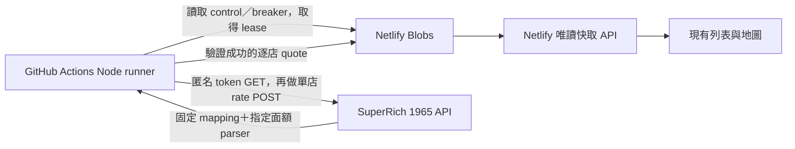

# SuperRich 1965：GitHub Actions 抓取與 Netlify 逐店快取計畫

更新日期：2026-10-20（Asia/Taipei）。狀態：Netlify 直接抓價入口已在本機程式退役，
三個公開 API 均改為只讀快取；本次變更尚未部署。Actions runner、抓價 workflow、
Secrets、Preview target 支援與排程仍未實作或啟用，沒有觸發來源請求或修改遠端報價／控制資料。

## 目標與目前證據

將橘標的來源 HTTP 請求移到 GitHub Actions，沿用本專案的匿名 API transport、
parser、固定分店 mapping 與保護機制；Netlify 保留 Blobs、公開 API 與前端。
先驗一家，再接 Preview 快取，最後才評估完整 38 家、排程與正式啟用。

| 已知結果 | 證據與限制 |
| --- | --- |
| 本機直接抓匿名 API 成功 | A04／36 的 token GET、rate POST 都 200；指定 USD／TWD 買入價有效 |
| 退役前本機 Netlify Function 成功 | 同一家冷查詢來源請求 2 次；再次查詢命中快取，來源請求 0 |
| 退役前 Netlify browser 模式失敗 | 官網頁面 navigation 回 403 challenge，尚未送匯率 POST |
| 退役前 Netlify anonymous-api 模式失敗 | 2026-10-19 22:50 的 Preview token GET 回 403 challenge，尚未送匯率 POST |
| ThaiCash 有 Actions 成功紀錄 | 當日 22:30 的 run 成功，資料檔橘標 `ok=true`；不是本專案的 runner 驗收 |

本專案的本機／Preview 詳細證據見
[匿名 API 調查紀錄](superrich1965-anonymous-api-investigation.zh-TW.md)。
目前只證明特定執行環境的結果，不能保證任意 GitHub runner 都可通過來源防護。

## ThaiCash 可借鏡的部分

[取價程式](https://github.com/mrfartman77/thaicash-data/blob/main/scrapers/booth_rates.py#L133)
以普通 Python HTTP 先取得匿名 token，再 POST external-app 介面。
[workflow](https://github.com/mrfartman77/thaicash-data/blob/main/.github/workflows/booth-rates.yml)
在 `ubuntu-latest` 執行抓取，使用 concurrency 防止重疊，最後 commit JSON。
[2026-10-19 22:30 的 run](https://github.com/mrfartman77/thaicash-data/actions/runs/39269563948)
成功，同批 [資料檔](https://github.com/mrfartman77/thaicash-data/blob/main/data/booth-rates.json)
記錄 `fetchedAt=2026-10-19T14:30:34Z`、橘標 `ok=true`、USD 33.43。
這是抓取時的公開佐證，不是持續更新的報價或獨立的來源時間驗證。

不能直接複製整份流程：

- 其橘標只查 `A04／36`，不含本專案全部 38 家；幣別清單沒有 TWD。
- 它每幣別取最高買入價；本專案必須精確匹配 USD `100-50`、TWD `1000-100`。
- 它設定 Safari User-Agent；本專案保留可識別的 User-Agent，不把其成功全部
  歸因於 runner 出口，也不以複製瀏覽器身分取代實測。
- workflow 成功不等於每個來源成功：程式允許部分來源失敗。因此驗收必須
  同時檢查橘標結果、來源 HTTP 狀態、分店、幣別、面額及時間。
- 查閱時最近五次 run 的 event 是 `workflow_dispatch`；workflow 註解另提到
  Cloudflare Worker 派送，原生 cron 是備援。不能由此推論 GitHub 原生排程準點。

本專案建議直接寫入 Netlify Blobs 的既有逐店 cache，讓資料更新不必經過
Git commit 與網站重新部署；不依賴 ThaiCash 的資料檔作為正式來源。

## 預計資料流程

來源 token 只存在該輪 runner 記憶體；不傳給前端、Netlify 公開 API、Blobs、
artifact、Git commit 或 log。Netlify 的 API／前端持續使用目前的 quote schema。

## 本機退役範圍與保留能力

- 已刪除 `exchange-rates-1965-fetch.mjs` Scheduled Function 與
  `exchange-rates-1965-refresh.mjs` Background Function，並移除 HTTP dispatch。
  shared `runSlowBatch()`、工作 token／job claim 與 12 分鐘預算仍保留，供後續
  外部 runner 重用；目前沒有任何 Actions runner 或其他部署入口呼叫它。
- 已刪除 browser helper、Chromium／Playwright dependencies 與專用打包設定。
  `EXCHANGE_RATES_1965_FETCH_MODE`、`EXCHANGE_RATES_1965_SOURCE_TRANSPORT`
  已從現行程式與設定範本退役；不得再用它們啟用 Netlify 抓價。
- `GET /api/exchange-rates-1965`、`GET /api/exchange-rates-1965-cache` 與
  `POST /api/exchange-rates-1965-branch` 均只讀已存報價。branch POST 路徑維持相容，
  缺少有效報價時回 `503 unavailable`、建議 60 秒後重讀；不取 token、不打來源、
  不寫快取，也不初始化 control 或取得抓價 lease。
- 保留 `EXCHANGE_RATES_1965_ENABLED`、control／lease／breaker、逐店 cache、
  anonymous source 與既有本機完整 snapshot CLI。公開 API 仍尊重停用、控制版本及
  原報價到期時間；CLI 尚未接匿名來源或 Preview target，不能當成完成的 Actions runner。

以上程式變更尚未部署。兩個退役環境變數已從 Netlify 專案所有 context 移除，
CLI 確認需重新部署才會套用；未刪除遠端快取、control 或 breaker。既有部署仍可能
執行舊入口；部署切換前須先核對舊工作與同來源冷卻。

## 現有程式與待補接線

| 目前能力 | Actions 需要補上的部分 |
| --- | --- |
| `createAnonymousApiSource()` 與 `ANONYMOUS_SOURCE_PROFILE` 保留 | Actions runner 直接建立匿名 session，將其 fetchImpl 與 profile 傳入逐店核心，一輪共用並在結束時 close |
| `queryBranchRates()` 已共用 control、breaker、CAS gate 與逐店 cache | 抽出可重用的執行入口；probe 另需明確的不發布路徑 |
| 本機 `fx:1965:fetch` 直接使用原 fetch 與 local profile | 它尚未讀取匿名 transport，不能只設定環境變數就搬入 Actions |
| 本機 CLI publish 寫完整 snapshot；相容公開 API 可讀該 snapshot | Actions 預計發布 `branches/{slug}` 逐店 cache，仍需實作發布與驗證接線 |
| `createAdminStore()` 固定連正式 site store | 新增明確 Preview deploy ID／production target，測試不得靜默回退正式 store |
| shared `runSlowBatch()` 保留 2～5 秒間隔、job claim 與預算 | 補上 Actions 工作建立／執行入口，維持既有間隔；anonymous profile 本身不是整輪 pacing |
| 三個 Netlify 公開 API 已只讀 cache，抓價 wrappers 已刪 | 尚須部署並驗收此退役變更，再接 Actions 來源工作 |

不更改綠標、Notion、CSV、分店 Slug、地圖 provider 或既有排序／報價有效期。
此文件沒有新增 CLI 命令或啟用中的 workflow；已退役的環境變數不再負責模式切換。
實作完成前不得把下列階段當作現成操作指令。

## 分階段驗證與交付

### A0：本機程式與 workflow 準備

- 新增可測試的 Node runner，沿用 parser、mapping、匿名 transport 及逐店流程。
  不另寫 Python parser，也不直接把舊 full-snapshot CLI 當成新 runner。
- target 必須明確：站台 ID、Preview deploy ID，以及預期部署／分支。
  預設為不發布，沒有 target 或控制資料不明確時來源請求為 0，不能預設正式環境。
- workflow 初版只接受手動觸發，沒有 schedule、push 或 PR 自動抓價。
  依 repo 規則完成本機檢查與審閱後，才另行取得發布 workflow 的授權。
- GitHub 要求 workflow 已存在預設分支，才可使用 `workflow_dispatch`。
  不能假設新檔僅存在功能分支就有 Run workflow 按鈕，或用 `--ref` 跳過此要求。
  首次可先審閱並發布僅供手動 probe、預設不發布報價的 workflow，之後選測試分支。
  [GitHub 手動執行文件](https://docs.github.com/en/actions/how-tos/manage-workflow-runs/manually-run-a-workflow)

### A1：指定 Preview 的手動單店 probe

- 固定先測 `superrich1965-58`（officialId=58、A04／36），不遍歷其他分店。
- 讀取該 deploy store 的 control、breaker、有效快取與共用 gate。服務停用、
  冷卻未結束或 lease 取得失敗，來源請求必須為 0。仍須尊重其他部署已知的
  同來源冷卻，不以換成 Actions、新部署或空 store 作為重新抓取理由。
- 22:50 的 Preview 曾記錄 `blockedUntil=2026-10-19T20:50:01.138Z`
  （台灣 10 月 20 日 04:50:01）。這是當次截止紀錄；執行前須重新讀最新狀態，
  不能硬編碼該時間，也不能把到期當成來源保證解封。
- probe 不發布 quote，但互斥 lease、來源失敗的 breaker／必要診斷仍需持久化。
  這是新 Actions probe 的待實作契約，與舊 CLI 的純遠端唯讀 dry-run 不同。
  現有 `queryBranchRates()` 成功會寫 quote，不能直接呼叫後宣稱完全未發布。
- 冷 session 預期 token GET 一次、rate POST 一次，兩者都 200，指定 USD／TWD
  買入價有效。若只命中 cache、來源請求為 0，應記為 cache hit，不能當成 runner
  網路成功的證據；不清快取或繞過刷新時機來製造冷查詢。
- token、rate 任何階段的 403／429／challenge 都立即停止，不重試、換介面、
  換 runner 或 refresh token。401、錯誤 JSON、缺面額及逾時明確記為失敗。

### A2：單店發布到 Preview 逐店 cache

- A1 成功後，才允許明確選用發布模式，目標仍固定為測試 Preview。
- 來源查詢與發布前後核對 controlVersion、enabledAt、lease 及 quote 身分。
  控制改變、失敗或衝突時不覆寫舊有效資料、不延長到期。
- 發布後由 `/api/exchange-rates-1965-cache` 驗證相同 quote；列表與兩個 map
  provider 的 popup 應同步顯示。原本完整 snapshot API 保持相容。
- 部署並驗收目前的 Netlify 只讀 API：有有效報價直接回傳；缺報價的 branch POST
  回 `503 unavailable` 與 60 秒重讀提示，不取 token、不寫 cache、不觸發 Actions。
  按鈕、提示與 loading 行為需有中英文驗證。
- 再讀／再查只應命中 cache，來源請求 0；服務停用後 API 不提供舊報價。

### A3：小批次，再驗證完整 38 家

- 先少量固定分店，再驗證完整 mapping。每家成功各自發布，沿用一個 session
  的記憶體 token；token 重用／到期語意與現有匿名 transport 相同。
- 每店完成後隨機等 2～5 秒，整輪維持 12 分鐘預算；不平行打 38 家，
  不因轉移到 Actions 就增加來源請求、重試或放寬既有逾時。
- 同 target 的 GitHub concurrency 之外，還需持久的工作認領與共用 Blobs lease。
  每個 runner 的本機 `.local-state` 都可能重建，不能作為跨 run 的冷卻／互斥依據。
  本機雖已刪除 Netlify 抓價入口，舊部署與未完成工作仍須在切換時核對，
  避免外部 runner 與任何尚在執行的來源工作重疊。
- 遇失敗、busy、冷卻、停用、控制版本變更或 deadline 即停止，保留已成功
  分店的原到期與既有 breaker 升級歷史；記錄 stoppedSlug 與實際來源請求數。

### A4：最後才啟用排程與正式發布

- 完成單店、批次、跨 run 控制與到期驗收後，才準備每半小時排程與正式切換。
  啟用時段另行確認；本文件不把第三方整日每小時 cron 當成本專案新需求。
- GitHub 原生 schedule 可能延遲，且從預設分支執行；不能承諾整點／半點即時更新。
  現有過期撤價與前端每分鐘讀本站 cache 的行為維持。
  [GitHub 排程限制](https://docs.github.com/en/actions/reference/workflows-and-actions/events-that-trigger-workflows#schedule)
- 正式 target、控制旗標、Secrets、workflow 發布及排程啟用依專案規則逐步授權。
  整個抓取週期直接更新 cache，不需 commit 報價或反覆觸發 Netlify deploy。

## 憑證、權限與隔離

| 項目 | 預計用途與保存位置 |
| --- | --- |
| `NETLIFY_AUTH_TOKEN` | GitHub Secret；供受信任 runner 存取指定站台 Blobs，不輸出值 |
| `NETLIFY_SITE_ID` | GitHub variable 或受控設定；固定本專案站台 |
| Preview deploy ID | 手動測試的明確 target，並核對部署身分；不是 production fallback |
| 匿名來源 accessToken | 每輪臨時取得，只存記憶體，不需預先設為 GitHub Secret |

workflow 只需 `contents: read`，不需要 commit/push 報價。首次不從不受信任的
fork／任意 PR 執行帶 Secrets 的來源工作，不使用 `pull_request_target` 取用其程式。
concurrency 依站台與 target 分組，正在抓取的工作不因新一輪直接被取消；
仍須有可到期的 Blobs 工作 lease，處理 runner 異常中止。

使用現有 `@netlify/blobs` 的外部執行環境憑證方式，Preview 與正式 store 明確分開。
不新增公開、可傳任意報價或 URL 的寫入 API；artifact 若用於除錯，只留經清理的
摘要，不放 token response、Authorization、Cookie 或原始 header。
[Netlify Blobs 文件](https://docs.netlify.com/build/data-and-storage/netlify-blobs/)

## 必須保留的資料與降級契約

- 只取 `buy_rate_amount`，不由 sell 或歷史價差推算。精確匹配 USD `100-50`、
  TWD `1000-100`，使用原本 1e6 整數表示；缺資料不得變成完整 quote。
- 分店由正式 mapping 指定，不能把一家的數字複製給其他 37 家。來源回應若
  不含分店身分，須保留此驗證限制，不把 caller echo 說成來源交叉核對成功。
- 到期仍為各店 attemptedAt 之後下一個整點／半點 +35 分鐘；讀取、token 更新
  與 CI 延遲都不延長報價。`data.update_time` 的業務語意仍未驗證。
- 停用／過期／失敗保留地點、收藏與連結；撤下不可用報價，排序只比較有效資料。
  Actions 故障不影響綠標，也不讓前端改為直接打官方來源。

## 待驗證清單

- [ ] Actions runner、明確 target 與不發布 probe 路徑。
- [ ] mock 覆蓋零來源前置保護、兩階段請求計數、token 到期、不重試及不洩漏。
- [ ] 既有冷卻結束後，GitHub runner 單店來源實測成功。
- [ ] Preview 單店 cache 發布、公開 API／列表／Google／HERE 顯示一致。
- [x] 本機已刪除 Netlify 抓價 wrappers、browser helper 與兩個來源模式環境變數；公開 API 改為只讀。
- [ ] 部署並驗收退役變更：公開 API 不發來源請求或寫入快取，缺報價正確回 503／60 秒。
- [ ] 小批次／38 家、逐店間隔、工作認領、跨 run breaker 與異常中止。
- [ ] 停用、過期、CI 延遲、部分失敗、部署 target 更換與回復流程。
- [ ] 經授權後才發布 workflow、正式切換與排程；目前皆未啟用。
